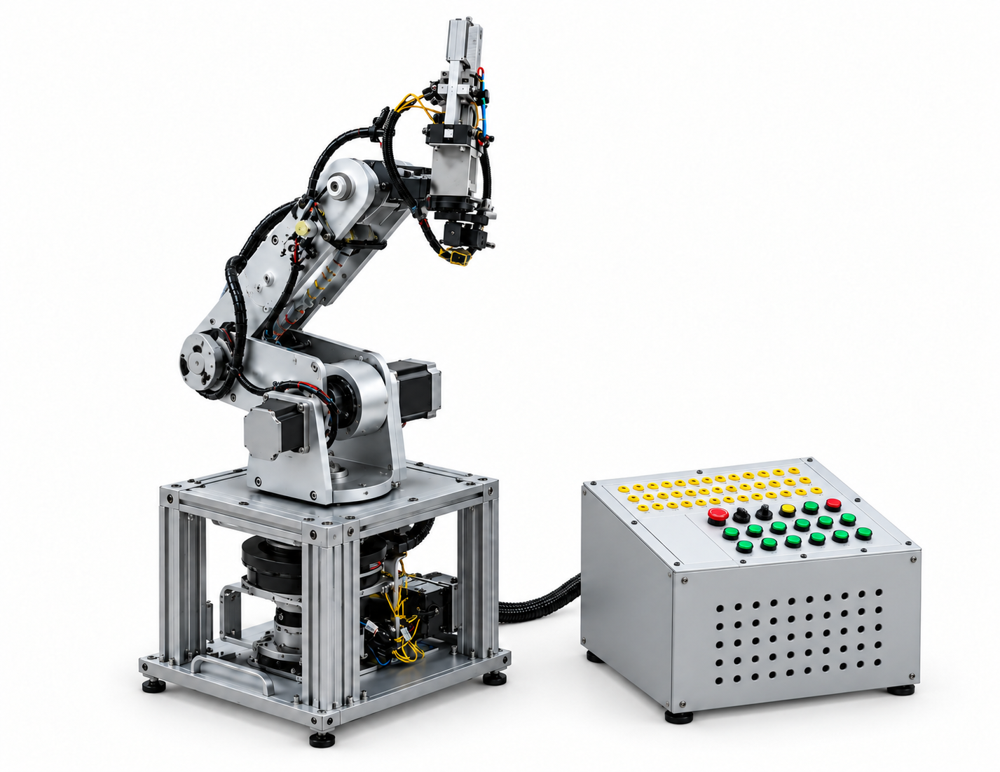
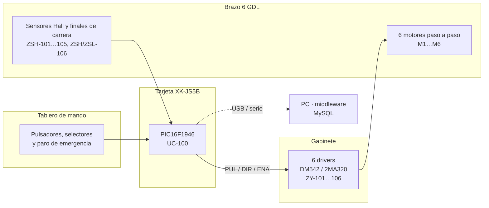

<div align="center">

# 🦾 Brazo Robótico de 6 GDL — XK-JS5B

**Repositorio de la planta del laboratorio integrado de Control y Sistemas**
Carrera de Ingeniería Electrónica · Facultad de Ingeniería · Universidad Mayor de San Andrés (UMSA)




<sub>Imagen ilustrativa del brazo y su tablero de mando.</sub>

</div>

---

## 📌 Sobre la planta

El **XK-JS5B** es un brazo robótico antropomórfico de entrenamiento con **seis grados de libertad**,
accionado por motores paso a paso y gobernado por una tarjeta con un microcontrolador **PIC16F1946**.
El nombre del modelo sigue el manual del fabricante y la serigrafía de la tarjeta; las guías de
laboratorio lo nombran *XK-LS5B*.

Este repositorio reúne **toda la documentación técnica de la planta**: planos ISA e IEC, pinaje de la
tarjeta, hojas de datos, manuales, guías, informes y el material heredado de semestres anteriores,
para que ninguna escuadra tenga que empezar de cero.

> **Estado actual:** la planta opera en **lazo abierto**. Los sensores Hall y los finales de carrera
> sólo cumplen funciones de protección y *homing*; el encoder de la base existe, pero no está cableado
> al controlador. Ver el [Informe 1](INFORMES/INFORME_1/INFORME_1.pdf).

---

## 🗂️ Contenido del repositorio

| Carpeta | Contenido |
|---|---|
| 📐 [`DIAGRAMAS P&ID`](DIAGRAMAS%20P%26ID/) | P&ID de la planta bajo **ANSI/ISA-5.1-2009** (`.dwg` y `.pdf`) |
| ⚡ [`DIAGRAMAS ELECTRICOS`](DIAGRAMAS%20ELECTRICOS/) | Planos bajo **IEC 60617**: placa y drivers, motores, pulsadores (`.dwg` y `.pdf`) |
| 📍 [`PINAJE PIC16F1946`](PINAJE%20PIC16F1946/) | Pinaje de la tarjeta respecto al PIC (proyecto **KiCad**) y símbolo del PIC |
| 📄 [`DATASHEET`](DATASHEET/) | Hojas de datos de los drivers 2M542 / 2DM542 y otros componentes |
| 📘 [`MANUALES`](MANUALES/) | Manual del XK-JS5B, MPLAB X, PICkit 3 e interfaz USB |
| 📝 [`INFORMES`](INFORMES/) | Informes de laboratorio de la gestión II/2026 |
| 📋 [`GUIAS DE LABORATORIO`](GUIAS%20DE%20LABORATORIO/) | Guías 1 a 8 del laboratorio integrado |
| 🖼️ [`FOTOS`](FOTOS/) | Fotografías de la planta y de la tarjeta de control |
| 🗄️ [`DOCUMENTACION ANTERIOR`](DOCUMENTACION%20ANTERIOR/) | Material de semestres anteriores: II-2022, I-2023, II-2023 y I-2026 |

---

## ⚙️ Arquitectura del sistema



### Articulaciones y lazos de control (ISA-5.1)

| Lazo | Articulación | Driver | Motor | Sensor de posición | Pin del PIC |
|:---:|---|:---:|:---:|---|:---:|
| 101 | Base | `ZY-101` | NEMA 23 | `ZSH-101` (Hall) · `ZT-101` encoder **sin conectar** | 58 · 48 |
| 102 | Hombro | `ZY-102` | NEMA 23 | `ZSH-102` (Hall) | 55 |
| 103 | Codo | `ZY-103` | NEMA 23 | `ZSH-103` (Hall) | 54 |
| 104 | Muñeca | `ZY-104` | NEMA 17 / 23 ⚠️ | `ZSH-104` (Hall) | 53 |
| 105 | Giro de muñeca | `ZY-105` | NEMA 17 | `ZSH-105` (Hall) | 52 |
| 106 | Pinza | `ZY-106` | NEMA 17 / 16 | `ZSH-106` / `ZSL-106` (finales de carrera) | 51 · 50 |

⚠️ La asignación de motor del eje 4 y la correspondencia SENSOR*n* → articulación deben confirmarse en la planta.

### Hardware principal

| Componente | Modelo | Función |
|---|---|---|
| Microcontrolador | **PIC16F1946** (64 pines, ADC de 10 bits, 2 EUSART) | Lógica de control de los 6 ejes |
| Drivers | **DM542 / 2M542** y **2MA320** | Conversión de pulsos en corriente de fase |
| Motores | NEMA 23 (57J1854-828), NEMA 17 (42J1848-604), NEMA 16 | Accionamiento de las articulaciones |
| Sensores de límite | **NJK-5002C** (Hall, NPN NA) y **M102-011** (microinterruptor) | Protección y *homing* |
| Encoder | **MBL3806-AB-600-24C** (600 PPR) | Previsto para cerrar el lazo de la base |
| Alimentación | Fuente conmutada **24 VDC** | Drivers, tarjeta y sensores |

---

## 📚 Avance del semestre (Gestión II/2026)

| Laboratorio | Tema | Estado |
|---|---|:---:|
| **Lab 1** | Ingeniería inversa, ficha técnica y reporte de discrepancias Kaizen | ✅ [Informe](INFORMES/INFORME_1/INFORME_1.pdf) |
| **Lab 2** | P&ID V2.0 (ISA-5.1), planos eléctricos (IEC 60617), pinaje del PIC y mockups HMI/ERP | ✅ [Informe](INFORMES/INFORME_2/INFORME_2.pdf) |
| **Lab 3** | Control de versiones con Git/GitHub y modelo de datos en 3FN (cierre de Fase 1) | 🔄 En curso |
| Labs 4–8 | Modelado dinámico, implementación y redes industriales (Fases 2 y 3) | ⏳ Pendiente |

---

## 🧭 Cómo usar este repositorio

1. **Para conocer la planta:** empezar por el [Informe 1](INFORMES/INFORME_1/INFORME_1.pdf) y el manual
   [`XK-JS5B English Manual`](MANUALES/XK-JS5B%20English%20Manual.pdf).
2. **Para cablear o dar mantenimiento:** usar los PDF de [`DIAGRAMAS ELECTRICOS`](DIAGRAMAS%20ELECTRICOS/)
   y el pinaje de [`PINAJE PIC16F1946`](PINAJE%20PIC16F1946/).
3. **Para programar el PIC:** revisar el pinaje (pines analógicos que deben configurarse como digitales,
   CCP2 reubicado en RE7) y los programas de semestres anteriores en
   [`DOCUMENTACION ANTERIOR`](DOCUMENTACION%20ANTERIOR/).
4. **Para modificar un plano:** crear una rama, editar el `.dwg`, exportar también el `.pdf` y abrir un
   *Pull Request* para su revisión.

### Convención de commits

```
tipo(alcance): resumen breve en presente
```

| Tipo | Uso | Ejemplo |
|---|---|---|
| `plano` | Cambios en P&ID o eléctricos | `plano(pid): renombra ZT-100 a ZT-101 (O-02)` |
| `doc` | Informes, manuales, README | `doc(informes): agrega informe del laboratorio 3` |
| `db` | Base de datos | `db(esquema): crea tablas en 3FN` |
| `fw` | Firmware del PIC | `fw(init): configura puertos según el pinaje` |
| `chore` | Organización del repositorio | `chore(repo): elimina archivos .bak` |

---

## 👥 Escuadra

| Integrante | Materia |
|---|---|
| Cristhian Daniel Cari Uluri ([@dancarCwC](https://github.com/dancarCwC)) | ETN-902 |
| Diego Josue Nina Fernandez | ETN-902 |
| Daniela Jhanin Callata Bautista | ETN-1034 |
| Giovanni Alexander Villca Yarari | ETN-1034 |
| Christian Yamil Gutierrez Ponce | ETN-1000 |
| Natalia Katerina Morales Corico | ETN-1000 |

**Docente:** Ing. Jorge Antonio Nava Amador
**Auxiliares:** Univ. Fabián Manuel Plata Vargas · Univ. Limber Ajnota Cahuaya · Univ. Franz Choque

---

<div align="center">
<sub>Laboratorio de Control y Sistemas · Carrera de Ingeniería Electrónica · UMSA · La Paz, Bolivia</sub>
</div>
